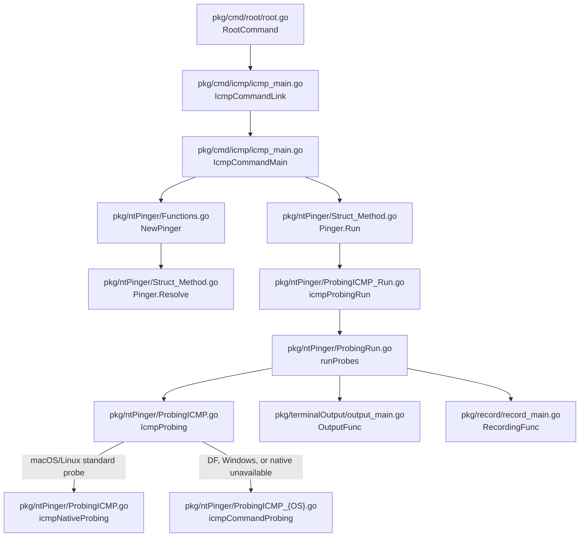
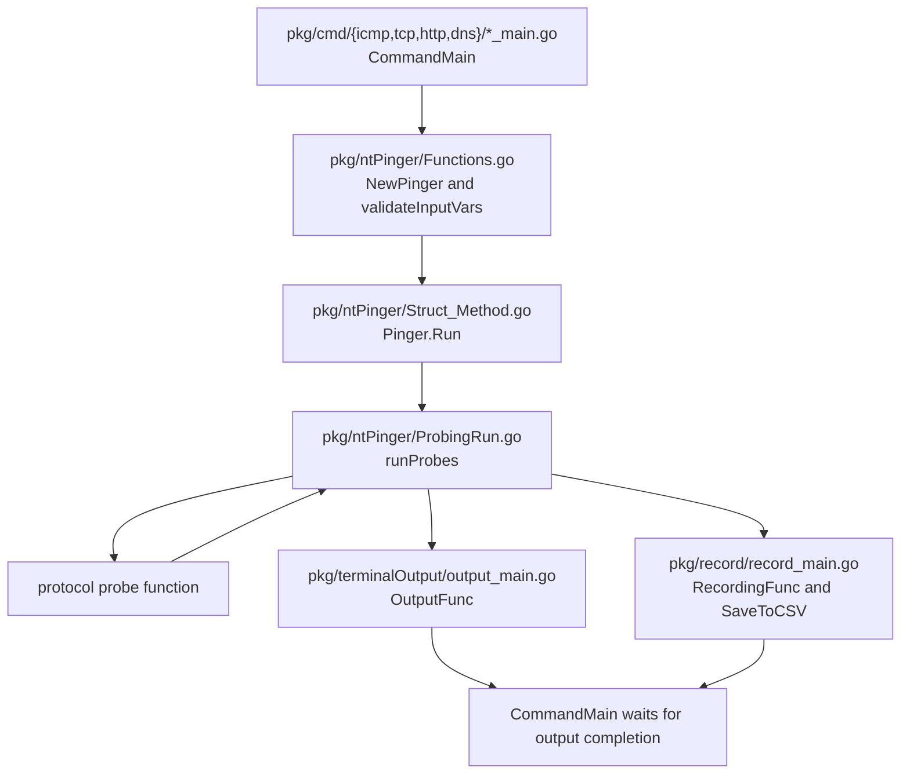
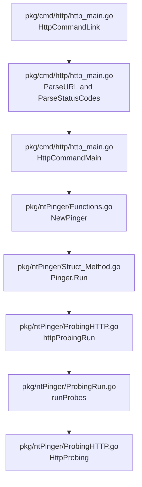
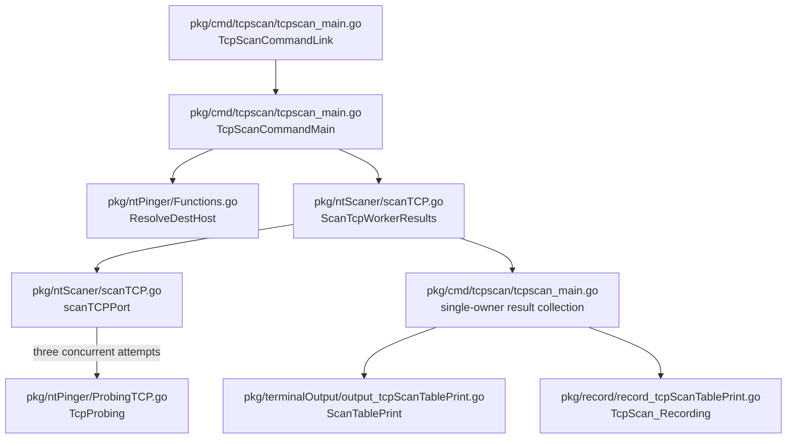
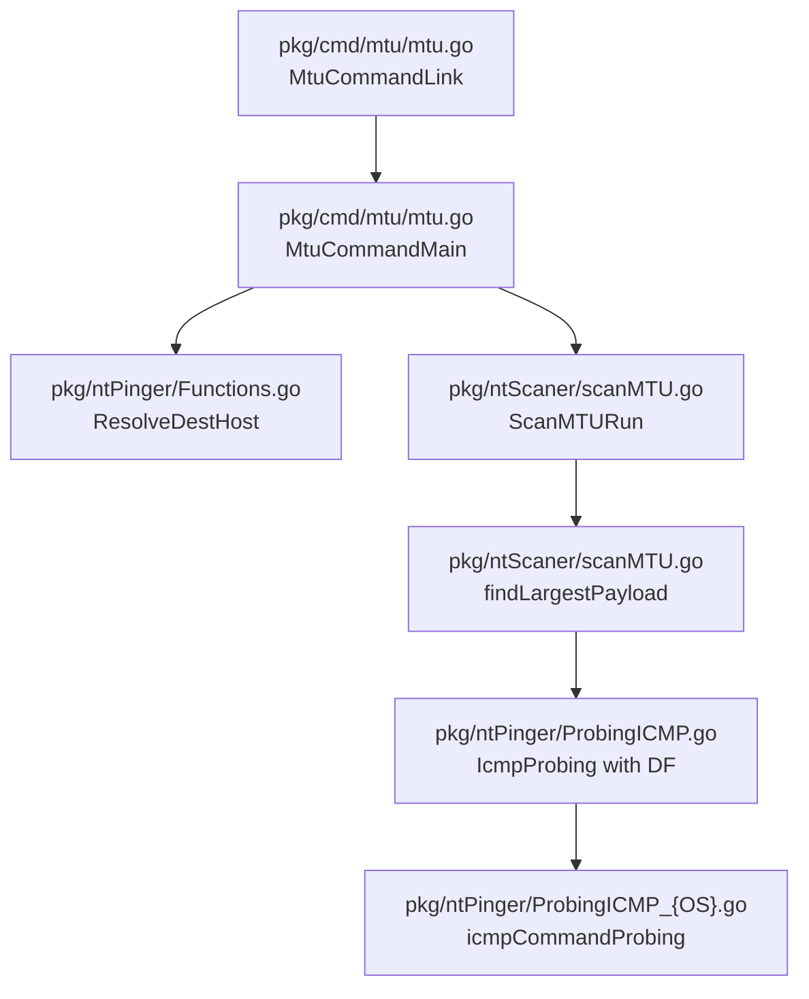

# Network Probe API Flows

## ICMP command

- Command: `nt icmp [flags] <host>`
- Request: host, count, payload size, timeout, interval, DF flag, display rows, and recording flag.
- Response: live `PacketICMP` rows, aggregate statistics, an optional CSV file, or a returned error.
- Frontend consumers: none; this repository provides a terminal CLI.

`IcmpProbing` keeps its existing public signature. Standard probes prefer the
unprivileged native transport on macOS and Linux. A socket availability or
permission failure selects the command compatibility path. DF and MTU probes
select that path directly because their socket options are platform-specific.

## Shared finite-probe lifecycle

- Commands: `nt icmp`, `nt tcp`, `nt http`, and `nt dns`.
- Request validation: nonnegative count and interval, positive timeout and display rows, valid payload and port ranges, and `udp` or `tcp` for DNS.
- Response lifecycle: each successful probe is emitted once; fatal errors stop the producer; output and optional recording finish before the command returns.
- Frontend consumers: none.

## HTTP command

- Command: `nt http [flags] <http-or-https-url>`
- Request: URL, method, allowed status codes, count, timeout, interval, optional proxy, display rows, and recording flag.
- Response: live `PacketHTTP` rows, aggregate statistics, an optional CSV file, or a returned error.
- Frontend consumers: none.

`ParseURL` accepts only HTTP and HTTPS URLs with a hostname and a port from 1
through 65535. It preserves the escaped request path and query string.

## TCP scan command

- Command: `nt tcpscan [flags] <host> <port-or-range> ...`
- Request: host, one to fifty valid TCP ports, timeout, and recording flag.
- Response: one immutable result per port, terminal scan statistics, an optional CSV file, or a returned error.
- Frontend consumers: none.

The command owns the shared display table. Workers receive values and return
values, preventing concurrent reads and writes to the table. The original
`ScanTcpWorker` function remains available for compatibility.

## MTU command

- Command: `nt mtu [flags] <host>`
- Request: host and a ceiling from 29 through 65535 bytes.
- Response: the largest confirmed IPv4 MTU at or below the ceiling, or an error when the minimum probe receives no reply.
- Frontend consumers: none.

The search first verifies reachability with a zero-byte payload and then uses a
bounded binary search. The payload bounds are `0` through `ceiling - 28`, where
28 bytes represents the IPv4 and ICMP headers.
